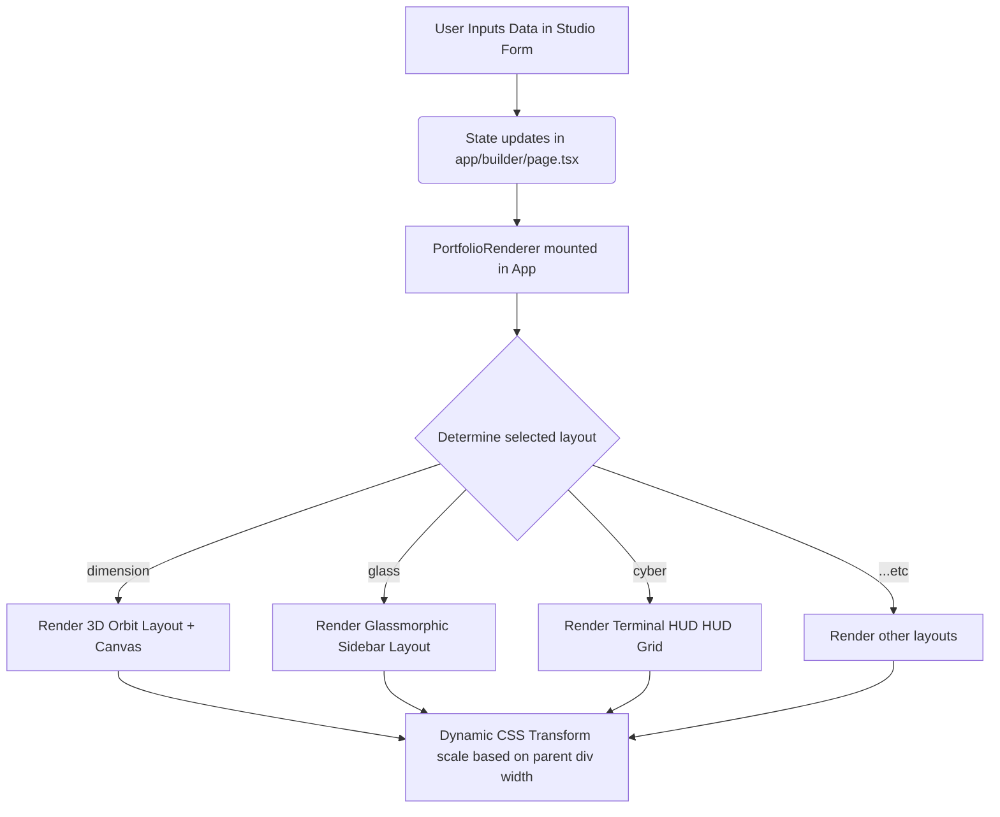
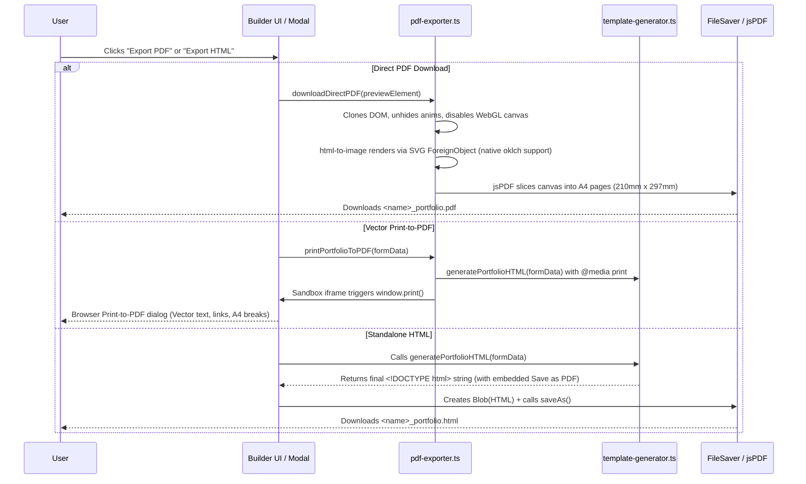

# Portfi (Premium Portfolio Studio) — Technical Documentation & Interview Guide

Welcome to the official developer-level architecture and interview preparation guide for **Portfi**. This document is designed to equip you with the deep technical knowledge required to present and explain this project with authority in a senior software engineering or full-stack web developer interview.

---

## 1. Project Overview & System Design

### What is Portfi?
Portfi is a premium, client-side, zero-database **static site generator and customizer (no-code studio)** built on **Next.js 16 (App Router)**. It allows high-caliber professionals to configure a personal portfolio in an interactive editor, preview the layout live with 3D elements, and export a single-file, highly optimized, production-ready static HTML page.

### The Value Proposition (The "Why")
* **Zero Infrastructure Overhead**: Since the HTML compiling happens entirely client-side, there are no database costs, serverless function expenses, or complex CI/CD build queues. 
* **Absolute Code Ownership**: The user downloads raw static code which they can host on GitHub Pages, Netlify, Vercel, or a private server without being locked into a hosting provider.
* **Premium Aesthetics**: The system provides seven unique design architectures (Minimal, Glassmorphism, Bento, Cyber HUD, Aurora Liquid, Neo-Brutalist, and 3D Dimension) integrated with high-fidelity WebGL particle animations and trigger-scroll entrance micro-animations.

---

## 2. Tech Stack & Architectural Decisions

### Framework & Language
* **Next.js 16 (App Router) & React 19**: Selected for modern component architecture, React Server Component layout patterns, client-side routing, and native support for React 19's performance optimizations.
* **TypeScript**: Enforces strict typing schemas for user data, experience blocks, project lists, and theme parameters, minimizing runtime bugs.

### CSS & Layout Styling
* **Tailwind CSS v4 & PostCSS**: Used to build a responsive, utility-first dark design system. Tailwind v4 introduces a revamped styling engine that integrates directly with css variables, significantly accelerating rendering times.
* **Radix UI Primitives (`@radix-ui/react-slot`)**: Provides clean, unstyled, accessible keyboard-navigable components.
* **`tailwind-merge` & `clsx`**: Allows clean conditional class joining without style duplication or conflicts.

### Graphics & Dynamic Interactivity
* **Three.js + React Three Fiber (`@react-three/fiber` & `@react-three/drei`)**: Serves as the React renderer wrapper around raw WebGL. Mounts dynamic 3D particle systems in the editor background.
* **Anime.js**: Utilized for lightweight, timeline-based entry animations and scroll-triggered stagger fades. Injected directly into the static exported file via CDN to keep the output standalone.
* **Framer Motion**: Powers smooth slide/fade visual step transitions within the Next.js app client-side UI when users toggle between workspace tabs.

---

## 3. High-Level Directory & File Structure

```
├── app/
│   ├── layout.tsx         # Global layout (imports fonts, setups HTML tag & globals.css)
│   ├── page.tsx           # Marketing/Landing page featuring core copy and entry button
│   ├── globals.css        # Tailwind directives and custom animation classes
│   ├── templates/
│   │   └── page.tsx       # Template Selection Screen (displaying the 7 architectures)
│   └── builder/
│       └── page.tsx       # Live Studio Editor (holds state, workspace forms, live preview iframe)
├── components/
│   ├── portfolio-renderer.tsx # React implementation of layouts for real-time sandbox preview
│   └── ui/
│       ├── button.tsx     # Custom styled button with shadcn variants
│       └── logo.tsx       # Custom SVG isometric 3D logo representing portfolio architecture
├── utils/
│   └── template-generator.ts  # HTML Compiler. Translates JSON state into a single-file static HTML
├── lib/
│   └── utils.ts           # Standard Tailwind Merge utility
├── package.json           # Project manifest defining modules and dependencies
```

---

## 4. Key Workflows & Code Flow Analysis

### Workflow A: Real-Time Preview Rendering Engine
The builder editor requires a responsive, high-performance sandbox preview that reflects changes as the user types.



1. **State Synchronisation**: The parent page `app/builder/page.tsx` acts as the single source of truth, managing a single `formData` state object.
2. **Dimension Adaptive Scaling**: Inside `BuilderContent`, a `ResizeObserver` monitors the preview frame's container size. It calculates the scale ratio: `previewScale = containerWidth / 1440`. Using CSS `transform: scale(previewScale)`, the app renders a 1440px desktop view inside a responsive preview container, avoiding typical responsive overflow bugs during editing.
3. **Scroll-Driven Animation Mounts**: `PortfolioRenderer` uses an `IntersectionObserver` to trigger entrance animations on any component decorated with the `.stagger-item` class. When a section scrolls into view, `animejs` smoothly slides and fades it up from `translateY(50px)` to `0px`.

---

### Workflow B: The Compilation & Hybrid Export Pipeline (HTML & PDF)
Exporting standard Next.js code as a standalone, framework-free single file or downloadable PDF requires compiling structured state into static HTML or multi-page PDF documents.



1. **Dependency Inlining**: To guarantee the exported file is self-contained, `template-generator.ts` references major runtime libraries via CDN links in the generated `<head>`:
   * Tailwind CSS engine (`cdn.tailwindcss.com`)
   * Three.js rendering library (`three.min.js`)
   * Anime.js animation framework (`anime.min.js`)
2. **Font & Theme Override Resolver**: In `generatePortfolioHTML()`, if the user keeps the default font (`sans`), the template overrides it with a font matched to its layout aesthetic:
   * `cyber` -> `'Space Mono', monospace`
   * `neo` -> `'Bebas Neue', sans-serif`
   * `aurora` -> `'Syne', sans-serif`
3. **Three.js WebGL Generator**: A vanilla JS bootstrapping script (`commonThree`) is inlined into the HTML. It hooks into `<div id="canvas-container">`, populates a buffer geometry with 3,000 float vertices, creates a `PointsMaterial` matching the user's selected theme accent color, and initiates a lightweight `requestAnimationFrame` loop.
4. **Local Download Triggers**:
   - **Direct PDF**: Uses `html-to-image` and `jsPDF` to render and slice high-resolution canvas captures into A4 page increments (`.pdf`), with full support for modern CSS Color 4 functions (`oklch`).
   - **Vector Print-to-PDF**: Injects customized `@media print` CSS rules and invokes the native print engine for 100% vector typography and clickable links.
   - **HTML Static Bundle**: Uses `file-saver` to download `<user_name>_portfolio.html`.
   All three pathways operate purely client-side without a backend server, maximizing speed, security, and portability.

---

## 5. Layout Architecture Deep Dive

The project features **seven distinct layout designs**, each implementing custom UX aesthetics and layout wrappers:

| Template Name | Design Philosophy | Structural Elements | Font & Visual Settings |
| :--- | :--- | :--- | :--- |
| **Classic Minimal** | Swiss Modernism | Sticky left sidebar (Name, Bio, Socials) and scrolling right column (Education, Stack, Projects, Legacy). | Heavy italic styling, high opacity changes on hover, thin white borders. |
| **Glass Studio** | Modern Glassmorphism | Entire site wrapped in a frosted pane (`glass` helper with `backdrop-filter: blur(50px)`). | Rounded-3xl containers, gradient text overlays, fluid scroll curves. |
| **The Bento Suite** | Dashboard Grid Layout | Interactive modular grids (iOS Style). Large grid blocks containing specific information blocks. | Solid background accents matching user's primary color, custom grid structures. |
| **Midnight Cyber** | Futuristic Tech HUD | Heavy border designs, green/cyan digital theme, technical logs prefixing elements (`// ARCHIVES`). | Monospaced fonts (`Space Mono`), neon accent colors, grayscaled image panels. |
| **Aurora Liquid** | Soft Organic Monolith | Centered monolith layout where text overlay elements mix-blend with a dark moving background. | Syne modern font, soft ambient glows, heavy text layout focus. |
| **Neo Brutalist** | High-contrast Impact | Bold outlines (`border-[12px] border-black`), no background gradients, bright yellow/white accents. | Ultra-bold condensed headings (`Bebas Neue`), sharp solid drop shadows, raw box borders. |
| **Dimension 3D** | Interactive WebGL Monolith | Immersive scrolling layout with full-bleed canvas and interactive 3D particle drift backgrounds. | Inter sans-serif font, floating card modules, wide-spaced margins. |

---

## 6. Senior-Level Interview Q&A (Prepare to Win)

Use these curated scenarios and conceptual answers to showcase your mastery of this codebase in technical interviews:

### Q1: "Why did you build the HTML exporter client-side rather than generating it on the server using Node.js?"
> **Answer:** "Building the compilation client-side makes the entire architecture serverless and infinitely scalable. In a typical server-side rendering architecture, we would have to spin up a Node.js process, parse templates, construct string templates, and stream the file down, which introduces database lookups, server load, security risks (like SSRF or resource exhaustion), and cloud hosting costs. By encapsulating our HTML layout templates in pure client-side TypeScript functions, we offload the processing power to the user's browser, achieve a zero-cost infrastructure model, and deliver a near-instantaneous download using `Blobs` and `file-saver`."

### Q2: "Since the live editor is built in React but the exported file is raw HTML, how do you prevent layout shift or visual drift between preview and production?"
> **Answer:** "To ensure complete fidelity, we decoupled the layout templates into parallel rendering tracks: `PortfolioRenderer` (which uses React-friendly JSX, `@react-three/fiber`, and Framer Motion) and `template-generator.ts` (which outputs raw HTML, Tailwind CDN, and vanilla Three.js scripts). Both systems consume the exact same design tokens, Tailwind style definitions, and canvas configurations. We also implement a responsive sandbox wrapper using CSS Transforms: instead of modifying grid sizes, we render the preview on a simulated 1440px desktop frame and downscale it relative to the container width. This ensures that what the user sees in the editor is exactly what gets written to their single-file static download."

### Q3: "WebGL and Three.js can be resource-heavy. How did you optimize memory usage and rendering performance inside the studio, especially when the user is typing updates rapidly?"
> **Answer:** "There are three core optimization strategies in place:
> 1. **React State Debouncing**: The inputs do not trigger canvas rebuilding. The 3D canvas is mounted once. We use React's `useMemo` to generate the 3,000 particle coordinate array (`Float32Array`) on mount, preventing garbage collection overhead during rapid form re-renders.
> 2. **Frame-Rate Throttle**: Inside the React Three Fiber loop, we use R3F's native `useFrame` hook, which ties the rendering frame rate directly to the browser's refresh rate and pauses execution automatically when the browser tab goes into the background.
> 3. **Static Output Optimization**: In the exported static HTML, rather than shipping React and react-three-fiber, we compile the WebGL logic down to pure, vanilla Three.js. This reduces the final JS bundle footprint from several megabytes of React overhead to a single static script that loads via a fast CDN, optimizing the First Contentful Paint (FCP)."

### Q4: "If you wanted to add database support, hosting, or authentication to scale this platform in the future, what steps would you take?"
> **Answer:** "I would scale this project into a SaaS product in three phases:
> 1. **Data Persistence (Database)**: Implement a backend layer using PostgreSQL with Prisma ORM. We would normalize the `FormData` schema into database relations (Users, Portfolios, Experiences, Projects).
> 2. **Host and Publish Flow**: Instead of downloading the HTML via `file-saver`, we could send the generated HTML content to an AWS S3 bucket configured for static web hosting. We would then map subdomains (e.g., `username.portfi.com`) to S3 endpoints, or utilize Vercel's/Netlify's Deployment API to trigger instant builds.
> 3. **Authentication**: Add NextAuth.js or Clerk to manage user profiles, subscription plans (e.g., locking premium layouts behind a Stripe checkout), and custom domain configurations."

---

## 7. Master Checklist for Your Pitch

When explaining this project to interviewers, frame the story as follows:
* **The Problem:** Developers and professionals spend hours coding portfolios from scratch or getting locked into heavy, expensive builders like WordPress or Squarespace.
* **The Solution:** A high-speed, zero-cost, static code-compiler that delivers custom, premium 3D landing pages in seconds.
* **The Engineering Achievement:** Seamless integration of client-side templating, responsive sandboxed UI rendering using CSS scaling, and WebGL optimization.
